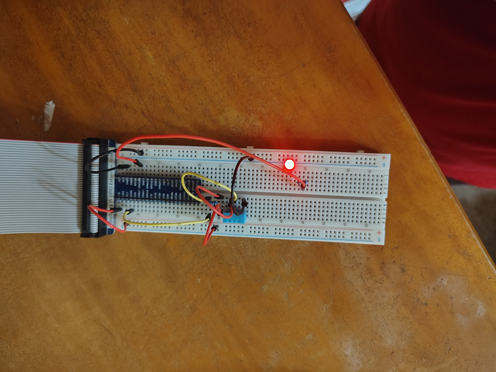
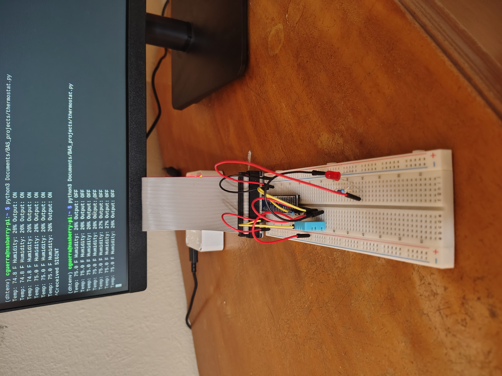
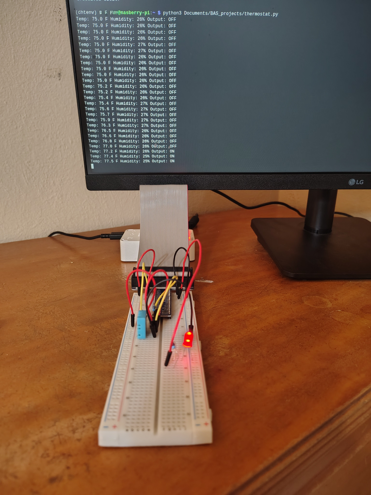

# Pi BACnet Controller

A Raspberry Pi 4 built as a small building-automation controller. It reads temperature and humidity from a DHT11 sensor, runs setpoint-and-deadband control, and drives an output. The next step is publishing the points as BACnet/IP objects (see the roadmap).

**Status:** sensor, control logic, and point-to-point checkout are done. BACnet integration is in progress.

Related project: [bacnet-ip-lab](https://github.com/crispy-dot/bacnet-ip-lab), where I captured and analyzed BACnet/IP traffic in Wireshark.



*The build, with the LED on. The Pi's header is broken out to the breadboard through a GPIO extension board and ribbon cable.*

## What it does

- Reads temperature and humidity from a DHT11 every 2 seconds.
- Compares temperature to a setpoint and switches an output with a deadband, the way a basic thermostat or VAV box does.
- Holds the output's last state while the temperature is inside the deadband, so it does not chatter.
- Skips bad sensor reads without crashing, and leaves the output unchanged.
- Turns the output off when the script exits.

## Hardware

| Part | Notes |
|---|---|
| Raspberry Pi 4 | Raspberry Pi OS |
| DHT11 temperature/humidity sensor | Bare 4-pin version |
| 10k resistor | Pull-up between DATA and VCC (not needed on 3-pin DHT11 boards, which include one) |
| LED and 220 ohm resistor | Output indicator |
| GPIO extension board and ribbon cable | Breaks the Pi's header out to the breadboard |
| Breadboard and jumper wires | |
| Fluke multimeter | Used for the checkout |

## Wiring

Pin numbers below are physical header pins. GPIO numbers are a different numbering system. The extension board labels its pins by function (3.3V, GPIO4, GND), so match each connection by label.

| Connection | Pi pin |
|---|---|
| DHT11 VCC | Pin 1 (3.3V) |
| DHT11 DATA | Pin 7 (GPIO4) |
| DHT11 GND | Pin 9 (GND), through the ground rail |
| 10k pull-up | Between DATA and VCC |
| LED long leg (anode), through 220 ohm resistor | Pin 12 (GPIO18) |
| LED short leg (cathode) | Pin 9 (GND), through the ground rail |

Everything shares one common ground. The sensor runs on 3.3V, not 5V, so the data line stays at a safe level for the Pi's GPIO.

## Running it



*Setpoint 75 F, deadband 2 F. In the first run the output is ON at 74.8 to 75.0 F. After a restart, the same 75.0 F shows the output OFF. Inside the deadband the output keeps its last state, and the script starts with the output off.*



*The temperature climbs past the setpoint. The output stays OFF through 77.0 F, then turns ON at 77.2 F, the first reading above setpoint + deadband (77 F). The LED is lit.*

## Software setup

Raspberry Pi OS blocks installing Python packages system-wide, so this uses a virtual environment. The `--system-site-packages` flag keeps `gpiozero` (installed through apt) visible inside it.

```bash
sudo apt update
sudo apt install -y python3-venv python3-gpiozero
python3 -m venv --system-site-packages ~/dhtenv
source ~/dhtenv/bin/activate
pip install -r requirements.txt
python thermostat.py
```

Run `source ~/dhtenv/bin/activate` in each new terminal before running the script. Press Ctrl+C to stop.

## How the control works

Settings are at the top of `thermostat.py`:

| Setting | Value | Purpose |
|---|---|---|
| `SETPOINT_F` | 75.0 | Target temperature |
| `DEADBAND_F` | 2.0 | Output turns on above setpoint + deadband and off below setpoint - deadband |
| `TEMP_OFFSET_F` | -3.0 | Calibration offset (reference minus sensor) |
| `READ_INTERVAL_S` | 2 | The DHT11 cannot be read faster than about once per second |

This sensor reports temperature in tenths of a degree Celsius. Each 0.1 C step is 0.18 F, and the output prints one decimal, so neighboring readings can look 0.1 or 0.2 F apart. Humidity comes in whole percent. The DHT11 is only accurate to about +/-2 C, so the extra digits are resolution, not accuracy. The deadband is wider than the reading-to-reading jitter, so the output does not chatter.

## Point-to-point checkout

I checked each point against a reference and with a multimeter. The full table is in [checkout_sheet.md](checkout_sheet.md).

| Check | Result |
|---|---|
| Temperature vs. reference | Reference 70 F, DHT11 73 F. Within the DHT11 spec of +/-2 C. Calibrated with a -3 F offset |
| Humidity response | Breath near the sensor raised it from 25% to 69%, then it fell back to 30% |
| Setpoint change | At a setpoint of 80 F, the LED turned on at 82 F and off below 78 F |
| Switching point | At a setpoint of 75 F and a 2 F deadband, the readings went 76.8, 77.0 (output OFF), then 77.2 (output ON) |
| Deadband | LED held its previous state with no flicker. The same 75.0 F showed the output ON in one run and OFF after a restart |
| Bad-read handling | Disconnecting the DATA wire printed "Bad read", with no crash and the LED holding state |
| Cleanup | LED turned off on Ctrl+C |

Meter readings:

| Measurement | Reading |
|---|---|
| 3.3V rail (pin 1 to ground) | 3.306 V |
| DATA line, idle | 3.3 V (pull-up working) |
| DATA line during reads | Dips to about 3.0 V on the meter, which averages the read pulses |
| Pin 12 to ground, LED on | 3.1 V |
| Pin 12 to ground, LED off | 0 V |
| Across the 220 ohm resistor, LED on | 1.1 V (about 5 mA) |
| Across the LED, LED on | 1.9 V |

### Fault found during checkout

With the LED on, the pin side of the resistor and the LED both measured 2.1 V. In a series circuit the drops should add up, so the pin side should have been higher than the LED by the resistor's drop. Two equal readings meant almost no voltage across the resistor, which meant the current was going around it. The cause was a jumper sharing a breadboard column with the resistor's LED-side leg. After moving it, the readings were 3.1 V, 1.1 V, and 1.9 V, which add up to about the pin voltage.

## Troubleshooting log

**`No module named 'board'`.** The `board` module comes from Adafruit Blinka, which is installed with the DHT library. Plain `pip install` failed because of the system package lock, so I used a virtual environment and installed inside it.

**`Unable to locate package` from apt.** The error message suggests `apt install python3-xyz`, but the Adafruit libraries are not in the apt repositories. The fix was the virtual environment, with pip.

**LED bypassing its resistor.** See the fault under the checkout above.

## Limitations

- The DHT11 is accurate to about +/-2 C. The datasheet lists 1 C resolution, though my unit reported tenths of a degree. It is fine for learning and checkout practice, not for precision control.
- The calibration is one-point, at room temperature, so the offset is only reliable near that temperature.

## Roadmap

- [ ] Publish the points as BACnet/IP objects with BACpypes3: temperature and humidity as Analog Inputs, setpoint as an Analog Value, and the LED as a Binary Output.
- [ ] Browse the Pi from YABE.
- [ ] Capture the traffic in Wireshark. The Pi is a separate machine, so the host can capture it directly.
- [ ] Add a short write-up on the security of the exposed BACnet device.
